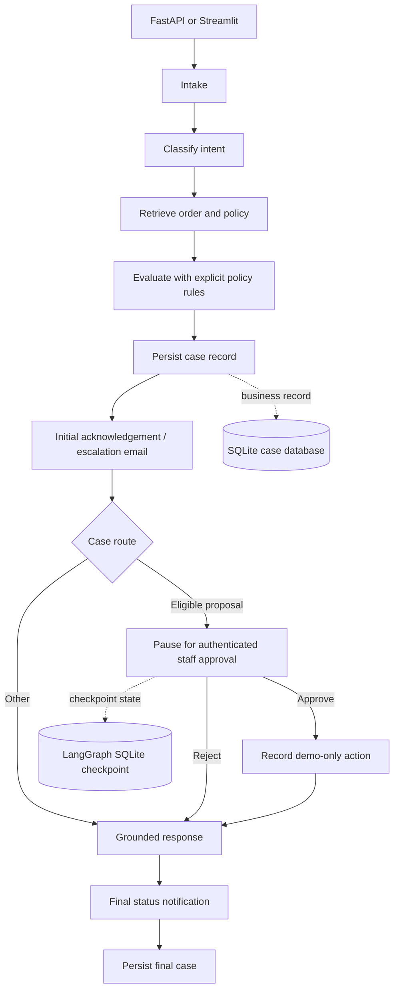

# AI Customer Support Agent

A local customer-support demo for return, refund, and order-status questions.
It combines the existing Streamlit chat, Gemini, policy retrieval, demo order
data, LangGraph orchestration, SQLite case/checkpoint storage, staff approval,
and optional email notifications. It does not connect to a live commerce or
payment provider and never issues a real refund.

## Architecture



LangGraph checkpoints preserve paused execution state for resume. The separate
case database is the durable business record; tickets remain in the existing
JSON ticket file. Order and policy tools remain local demo tools. Gemini can
call the policy, order lookup, and eligibility functions while preparing a
response, but deterministic code—not the model—controls eligibility,
escalation, and approval.

## Project structure

```text
app/
  api.py                  FastAPI endpoints and token checks
  case_store.py           SQLite case, action, and email idempotency records
  graph/
    state.py              Typed LangGraph shared state
    workflow.py           Nodes, routing, tool calls, approval interrupt
  tools/
    email_tool.py         SMTP notifications and dry-run preview
    escalation_tool.py   Manual-review ticket creation
    order_tool.py        Demo order lookup and eligibility rules
    retriever.py         Semantic policy retrieval
  main.py                 Existing Streamlit UI
data/
  orders.json             Demo order fixtures
  returnPolicy.txt        Policy source of truth
tests/                    Unit tests; no live API, email, or payment calls
```

Runtime database files are `data/cases.sqlite3` and
`data/checkpoints.sqlite3`; both are ignored by Git. LangGraph checkpoint
history and the case business record are deliberately stored separately.

## Setup (Windows PowerShell)

The project already has a `venv`; these commands reuse it and do not recreate
or delete it:

```powershell
.\venv\Scripts\python.exe -m pip install -r .\requirements.txt
```

Create a `.env` file only if one does not already exist:

```powershell
if (-not (Test-Path .env)) { Copy-Item .env.example .env }
```

If `.env` already exists, keep it and add or update the variables below without
replacing its existing contents. Do not commit `.env`.

```dotenv
GEMINI_API_KEY=
API_ACCESS_TOKEN=
STAFF_APPROVAL_TOKEN=
EMAIL_DRY_RUN=true
SMTP_HOST=smtp.gmail.com
SMTP_PORT=587
SMTP_USERNAME=
SMTP_APP_PASSWORD=
SUPPORT_EMAIL=
```

Use separate, long random values for `API_ACCESS_TOKEN` and
`STAFF_APPROVAL_TOKEN`. The API key protects the demo API. The staff token
protects approval; customers do not receive that token. For a local one-shell
test, PowerShell can generate temporary values:

```powershell
$env:API_ACCESS_TOKEN = [guid]::NewGuid().ToString("N")
$env:STAFF_APPROVAL_TOKEN = [guid]::NewGuid().ToString("N")
```

For normal use, persist secrets in a local secrets manager or `.env` (which is
gitignored), not in source control. Gemini is optional: deterministic answers
are provided when it is unavailable.

## Run locally

Start the API in one PowerShell window:

```powershell
.\venv\Scripts\python.exe -m uvicorn app.api:app --reload
```

The API is at `http://127.0.0.1:8000`; interactive OpenAPI docs are at
`http://127.0.0.1:8000/docs`. The unauthenticated health check is
`GET /health`. Start the React customer support frontend in a second
PowerShell window:

```powershell
Push-Location .\frontend
npm install
npm run dev
Pop-Location
```

Open the Vite URL shown in the terminal (by default
`http://127.0.0.1:5173`). Vite proxies `/api` requests to FastAPI on port
`8000` and supplies `API_ACCESS_TOKEN` from the project-root `.env` without
exposing it to the browser. Keep both development servers bound to localhost.
Gemini uses `GEMINI_API_KEY` from the project-root `.env`; when it is not set,
the workflow uses deterministic local responses.

The original Streamlit chat remains available separately, started with the
command below.

The existing Streamlit app can still be run separately:

```powershell
.\venv\Scripts\python.exe -m streamlit run app/main.py
```

The Streamlit chat also accepts an optional customer email and displays each
notification's status. Dry-run previews are shown in the conversation.

## API examples

`POST /api/chat`, `GET /api/cases/{case_id}`, and
`GET /api/cases/{case_id}/status` require `X-API-Key`. Chat submissions also
require `Idempotency-Key`: generate one for a new customer action and reuse it
for network retries so the API returns the original case rather than processing
the request twice.

```powershell
$headers = @{ "X-API-Key" = $env:API_ACCESS_TOKEN }
$headers["Idempotency-Key"] = [guid]::NewGuid().ToString("N")
$body = @{
    question = "I received a damaged product. Can I return it?"
    order_id = "ORD1001"
    customer_email = "customer@example.com"
} | ConvertTo-Json

$case = Invoke-RestMethod `
    -Method Post `
    -Uri "http://127.0.0.1:8000/api/chat" `
    -Headers $headers `
    -ContentType "application/json" `
    -Body $body
$case
```

If the order and policy support a return request, the response reports
`approval_required: true`. An authorized staff member resumes the same
LangGraph `thread_id` by approving or rejecting the case:

```powershell
$staffHeaders = @{
    "X-Staff-Token" = $env:STAFF_APPROVAL_TOKEN
    "X-Staff-Id" = "support-agent-1"
}
$decision = @{ decision = "approve"; reason = "Reviewed order and policy." } |
    ConvertTo-Json

Invoke-RestMethod `
    -Method Post `
    -Uri "http://127.0.0.1:8000/api/cases/$($case.case_id)/approval" `
    -Headers $staffHeaders `
    -ContentType "application/json" `
    -Body $decision
```

Use `"reject"` for the decision to reject. The API also supports:

- `GET /api/cases/{case_id}` — full persisted case (API token required).
- `GET /api/cases/{case_id}/status` — status summary (API token required).

The approval endpoint requires both the separate staff token and an
`X-Staff-Id` header. The submitted reviewer identity is recorded for demo
auditing; the shared-token approach is not a replacement for a production
identity provider, roles, or per-user authorization.

## Approval, actions, and escalation

An eligible return request is a proposal, not an approved refund. LangGraph
uses an SQLite checkpoint and an interrupt to pause the case. The approval API
resumes the same checkpoint thread with the staff decision. Rejections continue
to a customer response without executing an action. Approval records a
case-keyed, idempotent `simulated_only` outcome; it performs no return,
replacement, payment, or refund. Unrecognized orders, unsupported requests,
policy retrieval failures, and existing pending refund cases are escalated to
manual review. Tickets are de-duplicated by case ID.

## Email: safe preview and live mode

`EMAIL_DRY_RUN` defaults to `true`. In dry-run mode, email content is previewed
in the case's email notification record and no SMTP connection is opened.
Notification keys are persisted in SQLite so graph retries do not send the
same notification twice. Missing recipient addresses are recorded as skipped.

To enable live Gmail SMTP, set `EMAIL_DRY_RUN=false`, configure
`SMTP_HOST=smtp.gmail.com`, `SMTP_PORT=587`, `SMTP_USERNAME` to the sending
Gmail address, and `SMTP_APP_PASSWORD` to a Google App Password. Set
`SUPPORT_EMAIL` for escalation mail. SMTP failure is stored as a failed
notification and does not crash the workflow. Do not use an account's normal
Google password. A failed or interrupted in-flight send is not automatically
retried, to avoid accidental duplicates; reconcile it before manually
re-issuing.

No refund-completion email is sent: there is no payment provider or verified
refund result in this demo.

## Tests

From the project directory:

```powershell
.\venv\Scripts\python.exe -m pytest -q
```

Tests mock model/email integrations and use temporary SQLite/ticket files.
They do not use paid Gemini calls, send email, or execute payments.

## Limitations and production work

- API authentication currently uses shared demo tokens; replace it with a
  customer identity provider, staff roles, order ownership checks, CSRF/CORS
  policy as applicable, rate limits, and secret rotation before deployment.
- The sample order data and ticket JSON are local demo storage. Replace them
  with validated transactional database tables and an authorized commerce
  provider.
- Email previews and notification status are stored locally. Add appropriate
  access controls, retention, and PII deletion policies.
- No real refund, return label, replacement, or payment integration exists.
  A production payment action needs provider verification, approval policy,
  transaction idempotency, reconciliation, and audit controls.
- Add deployment settings, migrations, monitoring, operational recovery for
  stuck notifications, and model/policy evaluations before production.
