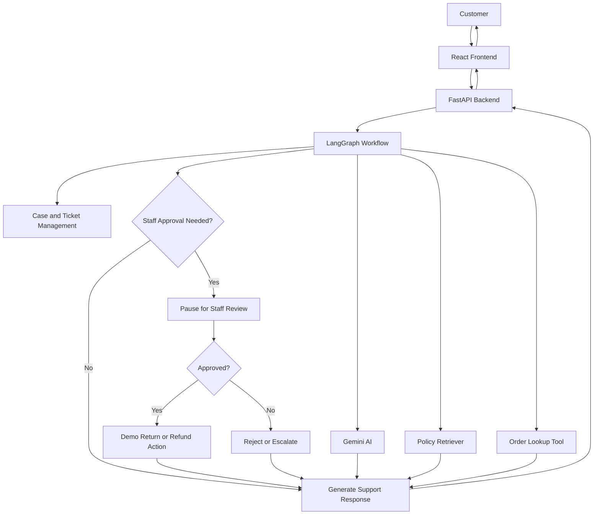
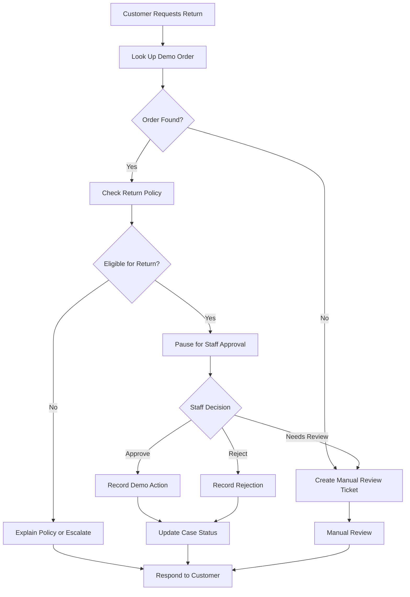

# AI Customer Support & Resolution Agent

An AI-powered customer support application that helps customers get answers to their questions, check demo orders, and request returns or refunds. It uses **React, FastAPI, Google Gemini, and LangGraph** to manage support conversations and guide requests through the appropriate workflow.

## Overview

The application provides a support assistant that can:

- Answer customer questions using store policy information.
- Look up orders from sample order data.
- Check whether an order is eligible for a return.
- Guide customers through return and refund requests.
- Pause eligible requests for staff approval.
- Create support tickets when a request needs manual review.
- Send email notifications or preview them in dry-run mode.

## System Architecture



## How It Works

1. The customer sends a message through the React frontend.
2. FastAPI receives the request and passes it to the LangGraph workflow.
3. The workflow uses AI and tools to understand the request and retrieve relevant information.
4. The assistant checks store policies, looks up sample orders, or guides the customer through the appropriate process.
5. If staff approval is required, the workflow pauses until an authorized staff member approves or rejects the request.
6. The application records case information and returns a response to the customer.

## Return and Refund Workflow



## Tech Stack

| Technology | Purpose |
|---|---|
| React | Customer support interface |
| FastAPI | Backend API |
| Python | Application logic |
| Google Gemini | AI-powered responses when configured |
| LangGraph | Manages the support workflow and approval process |
| SQLite | Stores support cases and workflow checkpoints |
| JSON | Stores sample order data |
| Semantic Retrieval | Finds relevant store policy information |
| SMTP | Optional email notifications |
| Pytest | Testing |

## Main Features

### 1. AI-Powered Support
The assistant understands customer questions and generates relevant responses using available policy information and AI capabilities.

### 2. Policy-Based Answers
A retrieval component searches store policy information to help answer questions about returns, refunds, and support procedures.

### 3. Demo Order Lookup
The order tool searches sample order data to retrieve order details and check return eligibility.

### 4. Staff Approval with LangGraph
Eligible return requests can pause the workflow until an authorized staff member approves or rejects them. LangGraph checkpoints help preserve workflow state during this process.

### 5. Case and Ticket Management
Support cases and actions are stored in SQLite. Requests requiring additional review can generate support tickets, with duplicate ticket creation controlled by case identifiers.

### 6. Email Notifications
The application supports optional email notifications. Dry-run mode is enabled by default so email previews can be generated without sending real emails.

### 7. API Security Controls
The API uses access tokens for protected requests, while staff approval requires separate staff authorization details.

### 8. Fallback Responses
The application can use a deterministic fallback when a Gemini API key is not configured, depending on the workflow path.

## Project Structure

```text
AI-Customer-Support-Agent/
│
├── app/
│   ├── api.py
│   ├── main.py
│   ├── case_store.py
│   │
│   ├── graph/
│   │   ├── state.py
│   │   └── workflow.py
│   │
│   └── tools/
│       ├── email_tool.py
│       ├── escalation_tool.py
│       ├── order_tool.py
│       └── retriever.py
│
├── data/
│   ├── orders.json
│   └── returnPolicy.txt
│
├── tests/
├── frontend/
├── requirements.txt
└── README.md
```

The exact files may vary as the project evolves. Local SQLite databases and environment files are kept separate from the main source code.

## API Endpoints

| Endpoint | Purpose |
|---|---|
| `POST /api/chat` | Send a customer message |
| `GET /api/cases/{case_id}` | Retrieve support case details |
| `GET /status` | Check API status |
| `POST /api/cases/{case_id}/approval` | Submit a staff approval decision |

Protected endpoints require the appropriate authorization headers.

## What I Learned

Through this project, I gained practical experience with:

- Building a full-stack application using React and FastAPI.
- Integrating an LLM into a customer support workflow.
- Using LangGraph to coordinate multiple workflow steps.
- Connecting AI workflows with tools for orders, policies, and escalation.
- Implementing human-in-the-loop approval.
- Persisting case data and workflow checkpoints using SQLite.
- Designing API access controls and testing application behavior.

## Current Limitations

- Orders and customer scenarios use sample data.
- Return and refund actions are demonstrations; no real payments or refunds are processed.
- Gemini features depend on API configuration.
- Email delivery requires SMTP configuration and remains in dry-run mode by default.
- The current authorization approach is intended for demonstration, not production use.

## Future Improvements

- Integrate with a real e-commerce platform.
- Add proper user authentication and role-based permissions.
- Build an analytics dashboard for support cases.
- Improve automated testing and monitoring.
- Add more customer support tools and workflow integrations.

---

**Project Focus:** Full-Stack Development · Generative AI · LLM Tool Calling · LangGraph · Human-in-the-Loop Workflows · API Development
